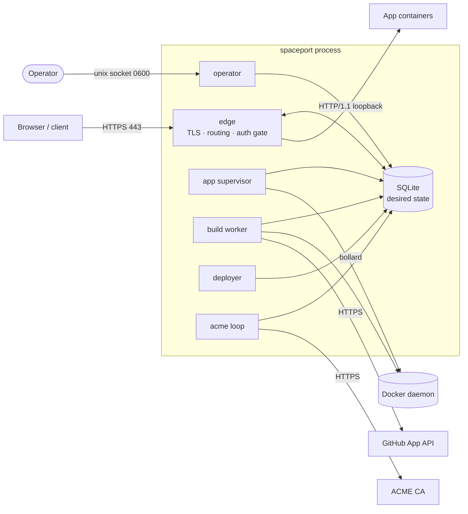
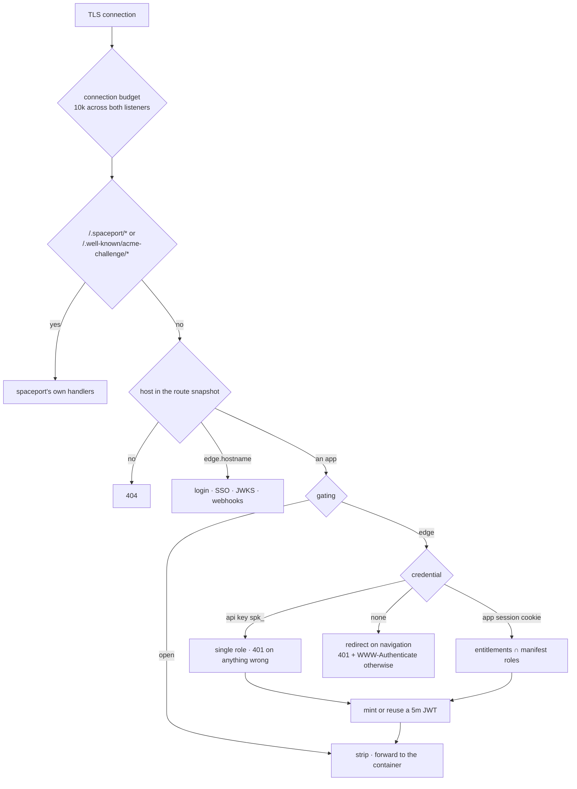
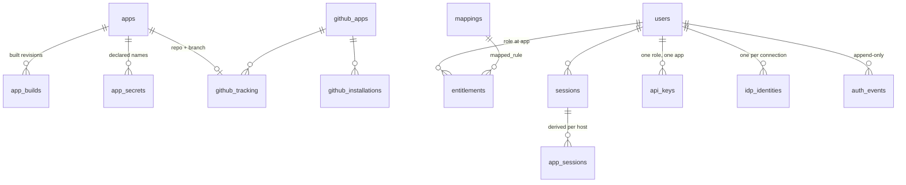
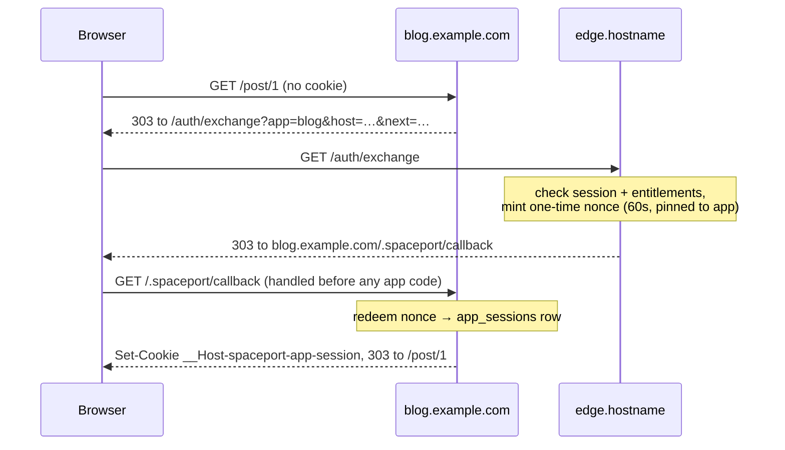

# Architecture

How spaceport is put together, and why it is put together that way. For what it does and how to operate it, see [README.md](README.md); for the contracts it offers a hosted app, `spaceport info manifest` and `spaceport info auth`.

## Shape

One Rust binary, one process, one host. `spaceport run` is the whole service: the edge, the operator interface, the container supervisor, the build worker, the deployer and the ACME loop all live in it as tokio tasks sharing one cancellation token. There is no scheduler, no queue broker, no second daemon. Persistence is one SQLite file.

Two crates:

- **`spaceport-core`** — the library. Everything: edge, operator, apps, auth, builds, connections, runtime, ACME, state, events, setup.
- **`spaceport-cli`** — the `spaceport` binary. The clap tree, the wiring in `run()`, and all terminal rendering. `src/info/manifest.md` and `src/info/auth.md` are embedded into it, so `spaceport info` answers out of the build in front of you and no repository can be behind on the contract.

## Tech stack

Rust, edition 2024, resolver 3. All dependencies are declared once in the workspace `Cargo.toml`, each with a written justification — that file is the dependency decision log.

| Area | Crates |
| --- | --- |
| Runtime | `tokio` (multi-thread, signals, `copy_bidirectional`), `tokio-util` (`CancellationToken`), `futures-util` |
| HTTP | `hyper` 1 (client + server, h1 + h2), `hyper-util`, `http`, `http-body-util`, `axum` 0.8, `tower` |
| TLS | `rustls` 0.23 with **ring**, `tokio-rustls`, `rustls-pemfile`, `rcgen` (dev certs), `hyper-rustls` |
| ACME | `instant-acme`, `x509-parser` |
| Crypto | `ring` only — Ed25519 signing, SHA-256 token hashing, `SystemRandom` for UUIDv4 and tokens. No `uuid`, no `jsonwebtoken`, no `sha2` |
| Storage | `rusqlite` with `bundled` SQLite |
| Containers | `bollard`, `tar` + `flate2` |
| Serde | `serde`, `serde_norway` (maintained serde_yaml fork), `serde_json` |
| CLI / time / logs | `clap` 4, `time` 0.3 (RFC 3339 everywhere), `tracing` + `tracing-subscriber`, `anyhow` |

Two standing choices behind those: **ring rather than aws-lc-rs** everywhere, and **bundled SQLite** — together they keep cmake, nasm and a system libsqlite out of the build, which is what makes the four-target static release build cheap.

## Module boundaries

`crates/spaceport-core/src`:

| Module | Owns |
| --- | --- |
| `edge/` | Public traffic. Accept loops and the connection budget (`mod.rs`), the request chain (`service.rs`), forwarding (`proxy.rs`), the auth gate and app-domain callback (`gate.rs`), spaceport's own hostname — login, SSO, JWKS, webhooks (`home.rs`), TLS resolution, WebSocket tunnelling |
| `operator/` | The private admin API: `server.rs` (routes), `client.rs`, `wire.rs` (the JSON DTOs both sides share) |
| `app/` | What spaceport runs: manifest, apply, store and routes, reconcile, supervisor, health, deploy, secrets, data directories |
| `auth/` | Users, entitlements, sessions, app sessions, API keys, JWT, mappings, SSO, the audit log |
| `build/` | Commit to image: archive fetch, unpack, build directories, image build, the worker |
| `connections/github/` | What spaceport *is* elsewhere: a GitHub App — API, JWT, registration, webhooks, tracking |
| `runtime/` | The `ContainerRuntime` trait and its docker implementation |
| `acme/` | The `CertificateAuthority` trait, accounts, orders, challenges, the rustls resolver |
| `state/` | `Db`, migrations, the state-directory lock |
| `events/` | The bus and the tracing layer that feeds `spaceport stream` |
| `setup/` | Binary, config and systemd unit installation |

Four boundaries are load-bearing:

- **`app` is what runs here; a `connection` is what spaceport is out there.** They are never the same table and never the same id space (`spaceport_app TEXT` vs `github_app_id INTEGER`). `connections` has exactly one implementation and no `Forge` trait — that abstraction waits for a second forge to argue for it.
- **`edge` is public, `operator` is private, and the operator interface is a unix socket and only ever a unix socket.** Mode `0600` in a `0700` directory, bound then chmod'd then renamed into place. That mode is the entire access control; there is deliberately no TCP option and no in-band admin role.
- **Nothing outside `state/` touches a `rusqlite::Connection`.** Callers go through `*Repository` types named after domain verbs.
- **Rendering is client-side.** The operator server answers prose, or typed rows under `Accept: application/json`; layout and colour are the CLI's business.

## Startup and the running loops

`spaceport run`:

1. Install two tracing layers — stdout under `RUST_LOG`, and the event layer feeding the bus under `SPACEPORT_STREAM`.
2. Load and validate the config.
3. Create the state directory (0700), take an advisory `flock` on it, open and migrate the database. The lock is what stops two spaceports fighting over the same labelled containers; a pid file would not.
4. Create the data and build directories. Connect to Docker and ping it, so an unreachable engine is a startup failure rather than a first-apply surprise.
5. Build the route snapshot, the JWT cache and the applier; reconcile once, adopting whatever containers the previous process left behind.
6. Spawn the background tasks: the app supervisor (engine event stream, timer sweep, liveness probes), GitHub installation reconciliation, the build worker, the deployer, ACME maintenance, and — with `--operator` — the operator server, whose failure cancels the edge with it.
7. Serve the edge in the foreground.

The loops are wired by three `Nudge` signals: reconcile, build, deploy. **A nudge means "go and look", never "do this."** Every pass re-reads the database, so a lost nudge costs latency, not correctness — and the trigger for a deploy is a row, not a message.

## Request path

The reserved-prefix check is a `starts_with` **before axum**, for two reasons: proxied traffic never has to box hyper's `Incoming` body, and no app can shadow the ACME responder or the auth callback.

Hostname lookup goes through an immutable `Arc<Routes>` snapshot. A suspended app keeps its hosts in it — that is what makes certificates keep renewing and resume always work. `edge.hostname` is an entry in the same table belonging to no app.

Upstream is plain HTTP/1.1 to a loopback port; TLS is spaceport's alone. `X-Forwarded-Host`, `-Proto` and `-For` are set (`-For` replaced, not appended), bodies stream unbuffered, and WebSockets are upgraded on both sides and joined with `copy_bidirectional` over a dedicated, never-pooled connection.

The edge's safety envelope lives in `edge/mod.rs`: a 10 000-connection budget shared across both listeners, a TLS handshake timeout, a first-word timeout, a header-read timeout and HTTP/2 keep-alive pings. A WebSocket tunnel holds its connection slot past the upgrade. The systemd unit's `LimitNOFILE` is derived from that budget rather than guessed.

## State

Exactly one SQLite file, `<state.directory>/spaceport.db`, mode 0600, WAL, behind a single `Arc<Mutex<Connection>>` — writes are rare and this sidesteps `SQLITE_BUSY` entirely.

**Only desired state is persisted.** Container ids and published ports are observed state and are rediscovered at startup by reconciliation. App volumes live outside the database under `data.directory`, one directory per app, never deleted — `destroy` takes the app, not its data. Build trees under `build.directory` are the only thing spaceport deletes.

Migrations (`state/migrations.rs`) are one ordered, append-only, forward-only list covering every domain, because there is one `user_version` per database. Tables are `STRICT`; timestamps are RFC 3339 UTC text. A database at a higher version than the binary is refused rather than guessed at. Each of the eighteen steps carries its rationale in a comment.

There are **no foreign keys anywhere**, deliberately: deleting a connection deletes its rows explicitly, and a constraint would turn an interrupted reconciliation into a failed one.

Roughly, the entities:

## Auth

The specification is `TMP_AUTH_SPEC.md`; the app-facing contract is `spaceport info auth`.

**Identity.** A `UserId` is a UUIDv4 minted from `ring`'s `SystemRandom`, never reused. The slug is a *name*: unique among live users, renameable in place without touching the `sub`, and re-creatable after a drop as a different user. The append-only `auth_events` table is where a dropped user's history survives; it is never updated, deleted or pruned. Every mutating auth command writes its event row **in the same transaction** as the change — that coupling is the module's one invariant.

**Entitlements** are `(user, app, role)`, so granting is idempotent. Rows carrying a `mapped_rule` came from SSO and cannot be revoked by hand — a manual revoke would be undone at the next login, so the answer is to drop the rule, which deletes what it produced.

**Sessions.** A session is a row plus an opaque 32-byte token stored as SHA-256; only the row is authoritative. The cookie `__Host-spaceport-session` lives on `edge.hostname`, 12 hours by default. Login codes are hashed and die at ten minutes, first use, or five wrong attempts — with an in-memory per-address throttle at the edge as the real bound against enumerating the code space. There is no sweeper: the writes that grow these tables clear expired rows on the way past.

**App sessions.** A cookie on `edge.hostname` cannot travel to `blog.example.com`, so each gated host gets its own derived credential through a redirect exchange:

Scheme and host are re-derived from the manifest at every hop, never taken from the request. A used or expired nonce restarts the exchange instead of erroring. App sessions inherit the parent's expiry and die with it in the same transaction.

**API keys.** `spk_` plus 32 random bytes, shown once, stored as SHA-256 with the last four characters kept for listings. A key buys exactly one role at one app and is deliberately **not** an entitlement row — widening or narrowing the user's grants must not silently change what the key buys. Every refusal on the key path is an indistinguishable `401` with no login hint and no log entry; there is no `403`, because a key never intersects the manifest.

**JWT.** Ed25519 / `EdDSA`, assembled by hand on `ring`. Claims: `iss` from `edge.hostname`, `sub`, `aud` (the app id), `iat`, `exp` at five minutes, a fresh `jti`, and `roles` = entitlements intersected with the *deployed* manifest's roles. Minting bails on an empty intersection — an empty set must be a `403` at the gate, never a token with no roles. Keys rotate every 90 days, checked lazily when the key is next needed; the JWKS serves the retired `kid` until every token signed by it has expired.

**Revocation.** The in-process `JwtCache` is the whole fan-out: one edge, so purges are immediate rather than eventually consistent. It holds cached JWTs *and* the live-WebSocket registry, folded together because the levers that kill a socket are letter-for-letter the levers that purge a token. Every repository that can narrow access is constructed with the cache, and the discipline is **commit, then purge**. The window an app must tolerate is the 4-minute cache TTL plus the 5-minute token — which is why the contract tells apps not to turn the token into a session of their own.

**Header hygiene.** For gated apps, `Authorization` is stripped after the key is read and replaced with spaceport's own token, and spaceport's cookies are removed from `Cookie`. For every host, gated or not, all `X-Spaceport*` request headers are stripped. Manifests may not declare any env var or secret starting with `SPACEPORT` — that is what stops an app being pointed at someone else's JWKS.

**SSO.** GitHub OAuth through the same GitHub App. The entire login — identity snapshot, entitlement re-sync, session, log rows — is one transaction; only the cache purge follows the commit. Resolution has exactly one rule: a stored `(connection, external_id)` names the user, and a stranger becomes a fresh user only if a mapping rule matches. **Email linking is forbidden and was removed**: a provider's "verified" email is a stale third-party claim about a different connection's credential, and honouring it would let anyone who ever held an address sign in as that user. A login never writes `users.email` either.

**Operator-asserted bindings.** `auth user connect` resolves a handle to the provider's stable external id at that moment and stores the binding against the id; the handle is kept for humans only. The binding grants nothing, evaluates no rules, purges no cache, and carries no attributes and a null `last_login_at` until the person actually signs in. Migration 18 exists to make that column nullable. It is legitimate because the operator is stating it under their own authority — the same authority that reaching the socket already implies.

**Mappings** are `<role>[,<role>]@<app> --via <idp> --when <attr>=<value>…`, AND-only, no negation. `evaluate` is a pure function, so `mapping test` and the live login re-sync cannot disagree.

## Testing

No `tests/` directory and no integration crate: around 1400 tests live in inline `#[cfg(test)]` modules next to what they test, across 74 files.

The strategy is **trait seams, not mocks of the world**. `CertificateAuthority`, `ContainerRuntime`, `Transport` (GitHub) and `Builder` exist so the interesting logic runs without a daemon, a CA or a network. `Db::in_memory()` runs the real migrations. Time is tokio's paused clock, kept a dev-dependency so it stays out of the shipped binary.

## Build, CI, release

CI runs on pushes to `main`, on pull requests, and on a **weekly cron** — advisories land against `main`, not against a PR. `RUSTFLAGS: -D warnings`. Three jobs: fmt + clippy + test; tarpaulin coverage (informational, no threshold yet, config in `tarpaulin.toml`); and `cargo deny check` against `deny.toml`, whose graph is restricted to the four shipped triples and which carries one advisory ignore with a written exit plan. Every `uses:` is pinned to a commit SHA with the version in a trailing comment.

Releases fire on `v*` tags and **call the CI workflow first** — a tag is not a promise the commit was tested. Four targets: `x86_64` and `aarch64`, gnu (built on ubuntu-22.04 for the lowest glibc floor) and musl (static, needing `musl-tools` because bundled SQLite is C). Artifacts are stripped, tarred, checksummed and attested with build provenance; only the publish job holds write permissions. `scripts/cross-compile.sh` is the local equivalent — it builds each target inside a container of that architecture rather than maintaining four cross toolchains, for the same reason: `rusqlite` compiles SQLite and `ring` compiles assembly.

Deployment is one binary and `spaceport setup`, which is idempotent: install to `/usr/local/bin`, write the config only if there is none, write and enable the systemd unit. Re-running it is the upgrade path. systemd only — on a Linux host, running a daemon at boot means systemd. Remote administration is `ssh` or a forwarded socket, by design.

## Where the decisions are written down

There is no ADR directory. The record lives in three places, and all three are meant to be read:

- **Module `//!` doc comments.** Nearly every file opens with several paragraphs of why-this-and-not-the-obvious-alternative. `state/mod.rs` on desired versus observed state, `state/migrations.rs` on one list and no foreign keys, `operator/mod.rs` on the socket, `edge/service.rs` on the prefix check, `auth/jwt.rs` on commit-then-purge, `auth/api_key.rs` on a key not being an entitlement, `auth/sso.rs` on why email linking went, `build/unpack.rs` on treating the archive as hostile, `acme/mod.rs` on one order per host, `secret.rs` on `Secret` deserializing but never serializing.
- **`Cargo.toml`**, where each dependency carries its justification.
- **`TMP_AUTH_SPEC.md`**, the auth specification. The `TMP_` prefix is accurate: it is the only durable spec in the repository and it does not have a permanent home yet.
